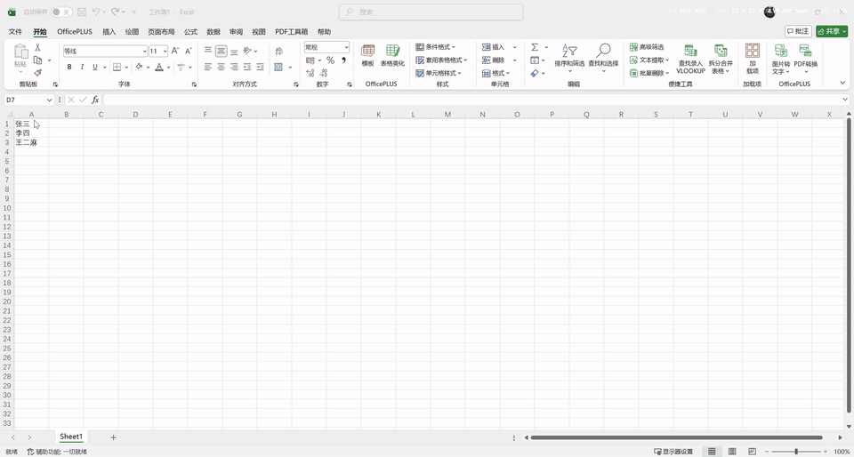
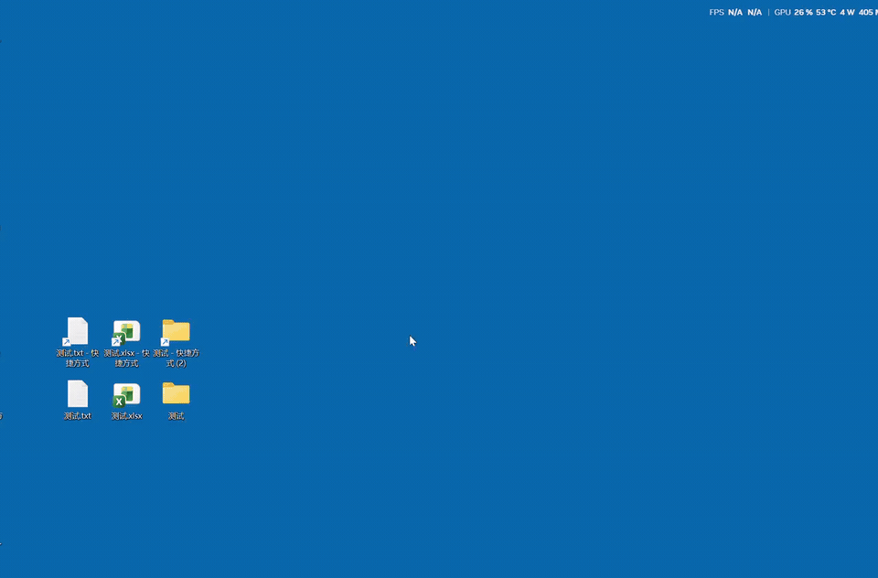

# 超级中键

## 为 Windows 原生重构的剪贴板轮盘


你是否厌倦了在多个窗口之间反复复制、粘贴和寻找历史内容？

超级中键是一款面向 Windows 的原生剪贴板轮盘工具。按住鼠标中键即可呼出轮盘，从最近复制的内容中快速选择，松开鼠标后直接粘贴到当前窗口。

2.0 系列已经完成原生 C++20 重构：启动路径更直接，减少运行时基础占用和大图片重复复制；剪贴板捕获、轮盘交互、渲染、更新与退出流程也重新收紧，带来更流畅、更稳定的操作体验。

本项目代码由 AI 编写，并经过人工功能与稳定性校验。

运行环境：Windows 10 1809 及以上或 Windows 11 x64，以及一个坚固的鼠标中键。

## 开源许可

主项目采用 [Apache License 2.0](LICENSE)。共享更新组件
`shared/DesktopUpdateKit` 作为 Git submodule 接入并采用 MIT License；完整归属说明见
[NOTICE](NOTICE) 和 [THIRD-PARTY-NOTICES.md](THIRD-PARTY-NOTICES.md)。

## 功能

| 功能 | 说明 |
|------|------|
| 中键轮盘 | 按住中键显示圆形/矩形轮盘，鼠标方向选择，松开粘贴；无历史时也可唤起空轮盘；轮盘激活期间拦截滚轮误触，避免 PPT 等应用翻页 |
| 突破轮盘 | 圆形模式下突破外缘可唤出外圈动作槽，支持快捷键、`.lnk` 快捷方式，以及直接拖入程序、文件和文件夹；未配置槽位不参与选中并回落到内圈选择 |
| 剪贴板历史 | 启动后台读取 Win+V 历史补底，运行期自己监听并置顶，维护最近 8 条 |
| 多格式 | 文本 / HTML / RTF / CSV / TSV，Excel/WPS 表格区域粘贴保留格式；可选清洗表格的纯文本载荷 |
| 表格文本清洗 | 可选删除表格纯文本中的横向空白、引号和首尾空行；下方的“换行清洗”子选项可将多行内容拼接成一段 |
| 图片支持 | 可选捕获剪贴板图片，轮盘使用缩略图预览，粘贴保留原图（设置中开启） |
| 快捷复制 | 最后一个扇区固定为 Ctrl+C 复制按钮 |
| 临时锁定 | 轮盘选中历史扇区后右键切换锁定，当前运行期内不被新剪贴板顶走 |
| 托盘 | 左键切换捕获开关，右键菜单（设置/清空/退出），双色图标；设置窗口保持单例 |
| 绿色免装 | 单 exe 运行，设置写入 `%AppData%\超级中键\settings.json` |
| 单实例 | 启动时自动检测并阻止重复运行 |

基础轮盘与突破动作演示：





## 下载

普通用户可从 [GitHub Releases](https://github.com/wet86y/clipboard-wheel/releases/latest)
下载最新稳定版。程序为绿色免安装单 EXE；当前尚未使用 Windows 代码签名证书，请仅从
本仓库 Release 获取，并保留随发布资产提供的许可证与第三方声明。

## 当前架构

主程序按 `app → ui/platform/updater → core` 的方向组织：

| 模块 | 职责 |
|------|------|
| `native/app` | 进程入口、AppHost 总编排、启动与退出顺序 |
| `native/ui` | 轮盘和设置窗口、Direct2D/DirectWrite/WIC 渲染、DPI 与设备重建 |
| `native/platform/windows` | 剪贴板/OLE、输入钩子、窗口与权限边界、设置持久化 |
| `native/core` | 历史、布局、选择和其他可独立测试的业务逻辑 |
| `native/updater` | 主程序与更新组件之间的宿主适配 |
| `shared/DesktopUpdateKit` | 独立维护的原生下载、校验、替换与回滚组件 |

共享更新组件以静态库接入主程序，更新 Stub 作为资源嵌入正式 EXE；发布目录仍只需要一个 `超级中键.exe`。

## 构建

超级中键 2.0 使用 C++20、Win32、Direct2D、DirectWrite、WIC、OLE 与 C++/WinRT，当前正式资产面向
Windows 10 1809 及以上和 Windows 11 x64，不依赖第三方运行时。源码位于 `native`，共享更新组件
位于 `shared\DesktopUpdateKit`。首次克隆必须初始化子模块：

```powershell
git clone --recurse-submodules https://github.com/wet86y/clipboard-wheel.git
```

已有工作区可执行 `git submodule update --init --recursive`。构建脚本通过 Visual Studio
Installer 自动定位 MSVC、CMake 和 Windows SDK，普通 PowerShell 不需要预先加载开发者环境。

| 类型 | 命令 | 产物位置 | 用途 |
|------|------|----------|------|
| 诊断运行版 | `.\scripts\run-dev.ps1` | `build\bin\RelWithDebInfo\超级中键.exe` 与 PDB | 保持优化和真实动画时序，启用结构化诊断日志 |
| 正式打包版 | `.\scripts\build-release.ps1` | `artifacts\超级中键-win-x64\超级中键.exe` | 单 EXE、无第三方运行时，分发用 |

`build\native` 只保存 CMake/MSVC 中间文件和测试程序，`build\bin` 只保存便于人工运行的
应用产物，`artifacts\超级中键-win-x64` 只允许存在正式 `超级中键.exe`。不得创建第二套
调试发布目录，也不得手工修改生成物。

## 项目文档

- `docs/ACCEPTANCE_TESTS.md`：完整人工验收清单。
- `docs/BUILD_OUTPUT_CONTRACT.md`：中间文件、诊断产物与正式包的唯一目录约束。
- `docs/EXTENDED_WHEEL_DESIGN.md`：突破轮盘布局和动作语义。
- `docs/LAUNCH_COMPATIBILITY.md`：浏览器、文档和 WPS 动作兼容规则。
- `docs/RELEASE_CHECKLIST.md`：原生版本发布门禁。
- `docs/SHARED_UPDATE_ARCHITECTURE.md`：原生程序如何接入 DesktopUpdateKit。
- `docs/UPDATE_DESIGN.md`：下载、替换、健康确认与回滚设计。
- `docs/用户使用说明.md`：普通用户使用说明。

## 托盘操作

- **左键单击**：切换中键捕获 开/关。图标即时变化（蓝色圆 = 开启，灰色圆 = 关闭）
- **右键单击**：弹出菜单（启用/禁用轮盘、设置、清空历史、退出）
- **设置入口**：只通过右键菜单的“设置”打开；重复点击只会激活已有设置窗口，不会创建多个。

## 设置要点

| 设置 | 说明 |
|------|------|
| 快捷复制 | 最后一个扇区固定为复制按钮（深绿色），选中即 Ctrl+C |
| 扇区锁定 | 轮盘打开时选中历史扇区并右键，蓝灰色表示锁定；再次右键解除。Quick Copy 扇区不可锁定；切换形状/扇区数后会按当前可见历史槽位归一化 |
| 图片捕获 | 默认关闭；打开后实时捕获剪贴板图片，轮盘中显示缩略图 |
| 表格文本清洗 | 默认关闭；删除表格纯文本首尾及正文中的横向空白、中英文引号与首尾空行，默认保留正文内部换行 |
| 换行清洗 | 表格文本清洗的子选项，默认关闭；开启后删除正文内部换行并拼接成一段，关闭父选项时同步关闭并禁用 |
| 形状/扇区 | 圆形 4/6/8（切换默认 6），矩形 4/8（切换默认 8） |
| 轮盘大小/死区/透明度 | 在基础设置页直接调整，保存后即时写入 settings.json（配置文件） |

基础设置使用三个卡片分组，轮盘设置与关于页面通过顶部标签切换。各页面可滚动，底部“保存 / 关闭”按钮固定显示；清洗增强的子选项使用缩进和较小开关表达从属关系。

粘贴模式固定为 Smart：单格文本走纯文本，表格 HTML 走格式化；含 `<table>` 的合并单元格自动识别。文本/富文本剪贴板捕获固定为全格式，图片捕获由设置开关单独控制，历史固定 8 条；中键轮盘是否启用由托盘图标/菜单控制。Ctrl/Shift 修饰键不再改变粘贴模式。

## 诊断

运行 `.\scripts\run-dev.ps1` 会构建并启动 `RelWithDebInfo`。诊断日志位于：

```text
%LOCALAPPDATA%\超级中键\logs\native-diagnostic-*.log
```

日志为 UTF-8 JSON Lines，不记录剪贴板正文、图片内容、完整路径、URL、窗口标题或用户输入。
提交前运行 `.\scripts\run-self-check.ps1`，它会构建 Release 与 RelWithDebInfo、执行全部 CTest、
检查 PDB 和资源，并重新生成唯一正式包。
